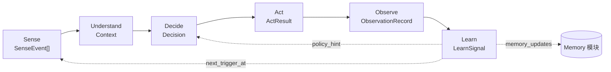

# 01. 六阶段最小接口契约

> 状态：设计草案（占位契约），不含具体实现。
> 目的：为 Loop Engine 提供统一的"插槽形状"，使任意参考实现（如 Aquaculture）都可以把自己的具体逻辑作为插件挂载到平台，而不需要平台理解业务语义。
> 关联：`docs/00-现状架构与平台化分析报告.md` §4、§6

---

## 1. 设计原则

1. **阶段之间只通过标准数据结构通信**，不允许跨阶段直接访问对方内部状态。
2. **每个阶段的数据结构都携带"血缘"字段**（如 `trace_id` / `decision_id`），保证 Observe/Learn 阶段可以回溯到最初的 Sense 事件。
3. **契约本身不包含任何业务字段**；业务专属信息统一放入各结构的 `payload: dict` / `metadata: dict` 字段，由参考实现自行定义结构（可选用 Pydantic 子类扩展）。
4. 所有阶段接口均为 **async**，因为现状中的 LLM 调用、HTTP 调用均是 I/O 密集型。
5. 每个阶段定义为 Python `Protocol`（结构化子类型），参考实现不需要继承基类，只需实现同名方法即可被 Loop Engine 接受，降低耦合。

---

## 2. 全局贯穿字段：`RunContext` 与 `trace_id`

```python
@dataclass
class RunContext:
    trace_id: str            # 一次完整闭环的唯一标识，贯穿六阶段
    loop_id: str              # 该 RunContext 所属的 Loop（图）定义 ID
    project_id: str           # 接入项目标识，如 "aquaculture"
    started_at: datetime
    metadata: dict[str, Any]  # 项目自定义的上下文（如 pond_id），平台不解析
```

`trace_id` 由 Loop Engine 在 Sense 阶段触发时生成，随每个阶段数据结构传递，是六阶段之间唯一的"强制关联字段"。

---

## 3. 阶段数据结构与接口

### 3.1 Sense

```python
@dataclass
class SenseEvent:
    trace_id: str
    source: str                # 事件来源标识，如 "sensor.do", "user.chat", "yolo.detect"
    occurred_at: datetime
    payload: dict[str, Any]     # 原始负载，平台不解析内容
    confidence: float | None = None   # 部分感知源自带置信度（如YOLO检测）

class SenseStage(Protocol):
    async def sense(self, ctx: RunContext) -> list[SenseEvent]:
        """拉取或接收原始信号，返回一批 SenseEvent。"""
```

- 现状映射：`ai_japan` 的传感器采集任务、`japan_shrimp_detect` 的检测结果、用户发来的聊天消息、`backend/build_pond_context` 拉取的多源数据，均可实现为一个 `SenseStage`。
- 一次 Loop 运行可以有**多个** SenseStage 并行执行（对应现状 `agent_new` 中"并行联网搜索 + 天气 + 用户消息"）。

### 3.2 Understand

```python
@dataclass
class Context:
    trace_id: str
    intent: str | None
    entities: dict[str, Any]
    confidence: float
    raw_events: list[SenseEvent]   # 保留原始事件引用，便于追溯

class UnderstandStage(Protocol):
    async def understand(self, events: list[SenseEvent], ctx: RunContext) -> Context:
        """将一批 SenseEvent 结构化为 Context（意图/实体/置信度）。"""
```

- 现状映射：`agent_new/core/intent.py` 的意图识别、`backend` 的"上下文JSON组装+确定性投喂率计算"。
- 允许 Context 是"规则计算结果"而非 LLM 输出（不强制要求用 LLM）。

### 3.3 Decide

```python
@dataclass
class Decision:
    trace_id: str
    decision_id: str            # 本次决策的唯一 ID（供 Observe/Learn 引用）
    action: str                 # 动作类型标识，如 "feed", "reply", "device_control"
    params: dict[str, Any]
    confidence: float
    rationale: str | None       # 决策依据（如 LLM 输出的理由，便于审计）
    requires_approval: bool = False   # 对应现状"审批后触发"场景

class DecideStage(Protocol):
    async def decide(self, context: Context, ctx: RunContext) -> Decision:
        """基于 Context 产出一个可执行的 Decision。"""
```

- 现状映射：`ai_feeding_task_generator.py` 的 LLM 生成任务 JSON、`agent_new` 的 if-else 路由决策、`deviceagent` 的 `device_router_node`。
- `requires_approval=True` 时，Loop Engine 在 Act 之前挂起，等待外部审批事件恢复（见 `02-LoopEngine设计.md` 的可中断-可恢复机制）。

### 3.4 Act

```python
@dataclass
class ActResult:
    trace_id: str
    decision_id: str
    status: Literal["success", "failed", "skipped"]
    output: dict[str, Any] | None
    error: str | None

class ActStage(Protocol):
    async def act(self, decision: Decision, ctx: RunContext) -> ActResult:
        """执行 Decision（通常是调用外部 Executor），返回执行结果。"""
```

- 现状映射：`work_task_service.py` 审批后 HTTP 调用 deviceagent、`agent_new` 转发设备专家/RAG 专家。
- Act 阶段的具体协议（HTTP/SSE/MQTT）由参考实现的 Executor 客户端实现，平台只定义 `ActStage` 契约（见 `05-仓库目录结构规划.md` 中 Act 执行网关的占位说明）。

### 3.5 Observe

```python
@dataclass
class ObservationRecord:
    trace_id: str
    decision_id: str
    outcome: Literal["as_expected", "deviated", "unknown"]
    metrics: dict[str, float]     # 如实际投喂量 vs 计划量
    observed_at: datetime
    raw: ActResult

class ObserveStage(Protocol):
    async def observe(self, act_result: ActResult, ctx: RunContext) -> ObservationRecord:
        """采集 Decision 执行后的环境反馈，产出结构化观测记录。"""
```

- 现状映射：`DecisionRecordingService.mark_success/mark_failed`。
- Observe 与 Decision Record 模块（`04-DecisionRecord设计.md`）直接对应：`ObservationRecord` 是 Decision Record 存储的核心记录单元。

### 3.6 Learn

```python
@dataclass
class LearnSignal:
    trace_id: str
    decision_id: str
    memory_updates: list[dict[str, Any]]   # 需要写入 Memory 的内容（可为空）
    next_trigger_at: datetime | None       # 下次触发 Loop 的建议时间
    policy_hint: dict[str, Any] | None     # 供 Decide 阶段下次参考的策略调整建议

class LearnStage(Protocol):
    async def learn(self, observation: ObservationRecord, ctx: RunContext) -> LearnSignal:
        """基于观测结果更新记忆/调整下次决策策略。"""
```

- 现状映射：`parse_and_clamp_next_decision`（决定下次何时决策）、对话历史写入（弱学习信号）。
- `LearnSignal.memory_updates` 是 Learn 阶段与 Memory 模块（`03-Memory设计.md`）之间的桥梁。

---

## 4. 阶段之间的最小依赖图



- 注意 `Learn` 到 `Sense`/`Decide` 的反馈是**异步的、跨 Loop 运行**的（例如"下次触发时间"影响的是*下一次* Loop 运行的启动时机，而不是当前这次）。这与现状 `decision_recording_service` 的行为一致：一次决策记录里写的 `next_decision_at` 是用来调度*未来*的一次运行。

---

## 5. 与 Loop Engine 的关系

Loop Engine（见 `02-LoopEngine设计.md`）负责：

- 按项目配置把六个阶段的具体实现（插件）注册为图节点；
- 按上面的依赖图（或项目自定义的变体，如插入"专家门禁"节点）编排执行顺序；
- 在阶段之间传递本文档定义的数据结构，并保证 `trace_id` 贯穿始终。

本文档定义的六个 `Protocol` 是 Loop Engine **认识的最小契约**；一个阶段的具体实现类只要方法签名和返回类型匹配，就可以被注册进任意 Loop，不要求实现细节。

---

## 6. 待确认事项（供后续讨论）

- `Decision.action` 是否需要一个平台级枚举，还是完全由项目自由定义字符串（当前倾向后者，保持平台无业务语义）。
- `ObservationRecord.outcome` 的三分类是否足够，是否需要项目扩展自定义分类。
- 是否需要在契约层强制所有阶段都是"单输入单输出"，还是允许 Sense/Understand 支持批量/流式（当前 Sense 已设计为返回 `list[SenseEvent]` 以支持批量）。

## ToDo Lists
- 调度器设置、分层配置
- 先深入设计三个模块：core、memory、observability；其余模块待详细设计
- 还需要实现基础的默认实现（Inmemory存储、 LoopEngine最简单运行时）