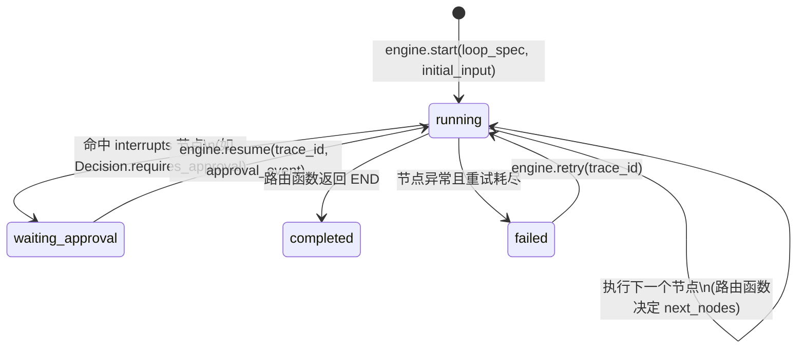

# 02. Loop Engine 设计

> 状态：设计草案。
> 目的：把现状中被独立实现了三次的"门禁→路由→分支执行"模式（`deviceagent/graph`、`agent_new` 路由、`cognitive_graph`）沉淀为平台统一的图编排运行时。
> 关联：`docs/00-现状架构与平台化分析报告.md` §4、§7；`docs/01-六阶段接口契约.md`

---

## 1. 定位

Loop Engine 是 ADP 的核心运行时，职责是：**把六阶段（或项目自定义的更细节点）的具体插件按图结构串起来执行，并管理一次运行的生命周期（启动/挂起/恢复/重试/超时/记录）**。

Loop Engine **不**：
- 不内置任何业务节点；
- 不规定必须使用某个具体 LLM 框架（LangGraph 是可选的节点内部实现细节，不是 Loop Engine 的依赖）；
- 不负责记忆/决策记录的存储细节（只负责在节点执行前后发出事件，交给 Memory / Decision Record 模块订阅）。

---

## 2. 现状三条实现的模式抽象

| 现状实现 | 门禁/预检 | 路由 | 分支执行 | 整合 |
|---|---|---|---|---|
| `deviceagent/graph/builder.py` | `expert_gate_node` | `device_router_node`（`Command(goto=...)`） | `feeder_agent_node` / `mac_agent_node` / ... | 无独立整合节点，执行节点即终态 |
| `agent_new/core/handler.py` | 意图预检（关键词） | if-else 分支（`is_device_control` 等） | 调用专家/设备/闲聊 | `_thinking_integrate()` |
| `cognitive_graph/agents.py` | 无 | `_router` 条件边 | analyzer → decision_maker → executor | 无 |

**共性抽象**：一个 Loop = **一组节点 + 一个路由函数（决定下一个节点或结束）+ 可选的整合节点**。这正是 Loop Engine 要标准化的最小图模型。

---

## 3. 数据模型

### 3.1 节点（Node）

```python
@dataclass
class NodeSpec:
    name: str                         # 节点唯一标识，如 "sense.sensor", "decide.feeding"
    stage: StageType | None           # 若对应六阶段之一，标注类型；自定义节点（如"审批门禁"）可为 None
    handler: Callable[..., Awaitable]  # 实际执行函数，签名需匹配对应 Stage Protocol，或自定义节点签名
    timeout_seconds: float | None = None
    retry: RetryPolicy | None = None
```

- 六阶段节点的 `handler` 直接是参考实现提供的 `SenseStage.sense` / `UnderstandStage.understand` 等方法。
- 自定义节点（如"专家门禁""审批等待"）不受六阶段契约约束，可以是任意异步函数，只要输入输出能被路由函数处理。

### 3.2 边/路由（Routing）

```python
@dataclass
class RouteResult:
    next_nodes: list[str] | Literal["END"]
    reason: str | None = None    # 便于审计"为什么路由到这里"

RouterFn = Callable[[Any, RunContext], Awaitable[RouteResult]]
```

- 支持**静态边**（固定 `A -> B`）和**动态路由**（`RouterFn` 根据上一个节点的输出决定下一步），对应现状 `Command(goto=...)` 和 `_router` 条件边。
- 支持**并行节点**（`next_nodes` 返回多个名字），对应现状"并行联网搜索+天气+用户消息"。

### 3.3 图定义（LoopSpec）

```python
@dataclass
class LoopSpec:
    loop_id: str
    project_id: str
    nodes: dict[str, NodeSpec]
    entry: str                       # 入口节点名
    routers: dict[str, RouterFn]      # 节点名 -> 该节点执行后使用的路由函数
    interrupts: set[str] = field(default_factory=set)   # 需要外部事件才能继续的节点（审批场景）
```

### 3.4 运行实例（LoopRun）

```python
@dataclass
class LoopRun:
    trace_id: str
    loop_id: str
    project_id: str
    status: Literal["running", "waiting_approval", "completed", "failed"]
    current_node: str | None
    started_at: datetime
    state: dict[str, Any] = field(default_factory=dict)  # 各节点输出的累积状态（含 Context/Decision/ActResult等）
    pending_node: str | None = None   # status=="waiting_approval" 时，等待外部事件的节点名
    error: str | None = None
```

`LoopRun` 的持久化通过 `LoopRunStore` 协议抽象（见 §8 A1 已确认结论），已实现，见 `adp/core/run.py` + `adp/core/store.py` + `adp/core/adapters/sql.py`。

---

## 4. 插件注册机制

参考实现（如 Aquaculture）通过注册表把自己的 Stage 实现挂载为节点：

```python
registry = LoopRegistry()

registry.register_node(
    NodeSpec(name="sense.pond_context", stage=StageType.SENSE, handler=build_pond_context_adapter),
)
registry.register_node(
    NodeSpec(name="decide.feeding", stage=StageType.DECIDE, handler=feeding_decider.decide),
)

loop_spec = registry.build_loop(
    loop_id="aquaculture.feeding_loop",
    project_id="aquaculture",
    entry="sense.pond_context",
    edges=[
        ("sense.pond_context", "understand.pond_context"),
        ("understand.pond_context", "decide.feeding"),
        ("decide.feeding", "act.trigger_device"),
        ("act.trigger_device", "observe.feeding_result"),
        ("observe.feeding_result", "learn.next_decision"),
    ],
)
```

- `build_loop` 只是把边列表编译为 `routers`（对静态边自动生成一个恒定路由函数；动态路由需显式传入 `RouterFn`）。
- 这样设计使 Loop 的**拓扑对项目可见、可 diff、可测试**，不需要在代码里翻找 if-else。

---

## 5. 运行时生命周期



关键能力：

1. **可中断-可恢复**：对应现状 `work_task_service.py` "AI生成任务 → 人工审批 → 触发执行"的场景。`Decision.requires_approval=True` 时，Loop Engine 自动把该次运行状态持久化为 `waiting_approval`，等待外部调用 `engine.resume()`。
2. **超时与重试**：每个 `NodeSpec` 可配置 `timeout_seconds` / `retry`，避免像现状代码中每个服务各自实现重试逻辑。
3. **状态持久化**：`LoopEngine` 通过可插拔的 `LoopRunStore` 协议持久化 `LoopRun`（默认 `InMemoryLoopRunStore`，SQL 版见 `adp/core/adapters/sql.py` 的 `SqlLoopRunStore`），保证进程重启后可以恢复 `waiting_approval` 的运行（对应现状 backend 重启后仍需继续处理待审批任务）。注意：`LoopRun.state` 里的节点输出是任意业务类型（各节点 handler 的返回值），SQL 版只做"最佳努力"的 JSON 安全序列化用于审计/查询，反序列化后是普通 dict、不重建原始 dataclass；`resume()` 的正确性不依赖于此，因为续跑时的输入由调用方显式通过 `event` 参数传入（见下方生命周期图），引擎只需要 `status`/`pending_node` 这两个能精确还原的字段就足以判断"该从哪个节点继续"。
4. **事件钩子**：每个节点执行前后触发事件（`on_node_start` / `on_node_end` / `on_loop_complete`），供 Decision Record 模块（`04`）和 Memory 模块（`03`）订阅写入，Loop Engine 本身不直接依赖这两个模块，保持解耦。

---

## 6. 与具体图引擎库（LangGraph 等）的关系

- Loop Engine 定义的是**平台自己的最小图协议**（`LoopSpec` / `NodeSpec` / `RouterFn`），不直接暴露 LangGraph 的 `StateGraph` API。
- 参考实现内部的某个节点（如 `decide.feeding`）**可以在其 handler 内部继续使用 LangGraph/LangChain** 来实现该单个节点的逻辑（例如复用现状 `deviceagent` 的 ReAct Agent），Loop Engine 不关心节点内部用什么技术，只关心其输入输出契约。
- 好处：未来若要替换某个节点的内部实现（例如把 LangGraph ReAct Agent 换成别的框架），不影响 Loop Engine 与其余节点。

---

## 7. 与现状三条实现的映射与迁移路径（说明性，不迁移代码）

| 现状实现 | 迁移为 Loop Engine 后的形态 |
|---|---|
| `deviceagent` 的 expert_gate → device_router → 设备节点 | 一个 `LoopSpec`：`gate.expert` → `route.device_type`（动态路由）→ `act.feeder` / `act.mac` |
| `agent_new/core/handler.py` 的 if-else 分支 | 一个 `LoopSpec`：`understand.intent` → 动态路由到 `act.expert` / `act.device` / `act.chitchat` → `integrate.thinking` |
| `cognitive_graph` 的 analyzer→decision_maker→executor | 一个 `LoopSpec`：`understand.analyze` → `decide.make_decision` → `act.execute` |

三者可以逐步迁移为同一套 Loop Engine 之上的三个不同 `LoopSpec` 配置，而不需要合并成同一个图（业务语义不同，图拓扑也不同，但运行时是同一套）。

---

## 8. 已确认事项（2026-07-10，见 docs/08）

- **A1 - 持久化后端**：已实现可插拔 `LoopRunStore` 协议 + 默认 `InMemoryLoopRunStore` + `SqlLoopRunStore`（SQLAlchemy async，见 `adp/core/adapters/sql.py`）。`state` 字段仅做审计用途的最佳努力序列化，见上文第 5 节说明。
- **A6 - 子 Loop 嵌套**：**不支持**。若某节点内部需要跑一个完整的六阶段小循环，由该节点的 handler 自己调用 `LoopEngine.start()`，平台不做特殊建模（一个节点的 handler 完全可以是"新建一个 LoopEngine 实例并同步等待其跑完"，对外层 Loop 而言只是一个普通节点）。
- **RouterFn 权重/优先级**：未在本轮讨论范围内，维持当前"显式返回列表、无权重"的设计，留待后续需要时再扩展。
