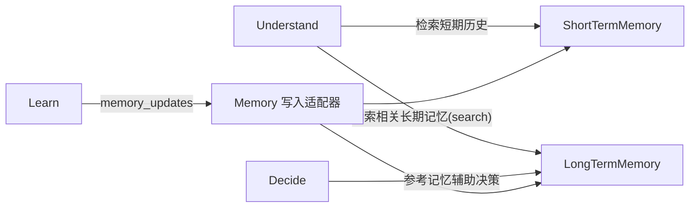

# 03. Memory 设计

> 状态：设计草案。
> 目的：把现状中设计最完整的 `cognitive-center/cognitive_model/hippocampus/*` 抽象为平台级、与业务无关的记忆模块。
> 关联：`docs/00-现状架构与平台化分析报告.md` §3.2、§5.1；`docs/01-六阶段接口契约.md`（Learn 阶段的 `memory_updates`）

---

## 1. 定位

Memory 模块为 ADP 提供两类记忆能力：

- **短期记忆（Short-term Memory）**：单次会话/单条 trace 内的上下文历史，供 Understand/Decide 阶段快速检索最近上下文。
- **长期记忆（Long-term Memory）**：跨会话、跨时间的知识沉淀，以"主题（Topic）+ 记忆节点（MemoryNode）"的形式组织，供 Learn 阶段写入、Understand/Decide 阶段检索。（**参考腾讯的一篇论文**）

Memory 模块**不**：
- 不规定存储后端（DB / 向量库 / 文件均可，平台只定义接口）；
- 不包含任何业务主题词（"南美白对虾""死虾"等主题内容由参考实现产生，平台只存储抽象的 Topic 字符串和 Payload）。

---

## 2. 现状能力映射

| 现状实现 | 能力 | 平台化后的模块 |
|---|---|---|
| `hippocampus/session_handler.py` `load_session_history` | 短期记忆：按 session_id 加载对话历史 | `ShortTermMemory.load(session_id)` |
| `hippocampus/handler.py` `find_master_topic` | 主题聚类：用 Agent 判断候选主题是否归入已有 master topic，解决"主题漂移" | `LongTermMemory.resolve_topic(candidate_topic)` |
| `hippocampus/handler.py` `load_memory_node_by_master_topic` | 记忆节点检索/创建 | `LongTermMemory.get_or_create_node(master_topic, scope)` |
| `hippocampus/handler.py` `update_memory_node` | 记忆节点更新（对话历史、摘要、元数据） | `LongTermMemory.update_node(node_id, updates)` |
| `agent_new/services/chat_history_service.py` | 会话历史持久化 | 归入 `ShortTermMemory` 的存储后端实现 |

---

## 3. 数据模型

### 3.1 短期记忆

```python
@dataclass
class ShortTermEntry:
    session_id: str
    trace_id: str | None
    role: Literal["user", "assistant", "system", "event"]
    content: Any
    occurred_at: datetime

class ShortTermMemory(Protocol):
    async def append(self, entry: ShortTermEntry) -> None: ...
    async def load(self, session_id: str, limit: int = 50) -> list[ShortTermEntry]: ...
    async def clear(self, session_id: str) -> None: ...
```

### 3.2 长期记忆

```python
@dataclass
class MemoryNode:
    node_id: str
    scope: str                  # 归属范围，如 project_id 或更细的租户/设备维度
    master_topic: str           # 主题聚类后的规范主题名（不含业务语义假设，纯字符串）
    summary: str | None
    payload: dict[str, Any]     # 具体记忆内容，由参考实现定义结构
    updated_at: datetime

class LongTermMemory(Protocol):
    async def resolve_topic(self, candidate_topic: str, scope: str) -> str:
        """将候选主题归一化/聚类为已有的 master_topic，或注册为新主题。"""

    async def get_or_create_node(self, master_topic: str, scope: str) -> MemoryNode: ...

    async def update_node(self, node_id: str, updates: dict[str, Any]) -> MemoryNode: ...

    async def search(self, query: str, scope: str, top_k: int = 5) -> list[MemoryNode]:
        """检索相关记忆节点，具体实现可以是关键词/向量检索，平台不限定。"""
```

- `resolve_topic` 的具体聚类算法（现状用一个 LLM Agent `TopicMatcherAgent` 判断）不属于 Memory 模块本身，而是可插拔的 `TopicResolver` 策略（见下）。
- `search` 预留检索接口，方便未来接入向量库，但第一版可以只实现精确匹配/关键词匹配。

### 3.3 主题聚类策略（可插拔）

```python
class TopicResolver(Protocol):
    async def resolve(self, candidate_topic: str, existing_topics: list[str]) -> str: ...
```

- 现状的 `TopicMatcherAgent`（LLM 判断）是 `TopicResolver` 的一种实现，属于参考实现层，不属于平台核心（平台只要求"给定候选主题和已有主题列表，返回归一化主题"这个契约）。
- `LongTermMemory` 的默认实现可以内置一个"字符串精确匹配"的最简 `TopicResolver`，作为平台自带的基线实现（无需 LLM 即可用），项目可替换为更智能的版本。

---

## 4. 与六阶段/Loop Engine 的关系



- Loop Engine 不直接依赖 Memory 模块；而是通过事件钩子（见 `02-LoopEngine设计.md` §5"事件钩子"）在节点执行前后，由一个**订阅者（Memory Writer）**把 `LearnSignal.memory_updates` 写入 `ShortTermMemory`/`LongTermMemory`，保持解耦。
- Understand/Decide 阶段的具体 handler（属于参考实现）可以按需主动调用 `ShortTermMemory.load` / `LongTermMemory.search`，这属于"参考实现使用平台能力"，不是 Loop Engine 强制的步骤。

---

## 5. 存储后端设计

- Memory 模块本身只定义 `ShortTermMemory` / `LongTermMemory` 两个 Protocol，具体存储实现作为可替换的 Adapter：
  - `SqlShortTermMemory` / `SqlLongTermMemory`（对应现状 MySQL 表 `chat_history` / `topic_memory`）
  - `InMemoryShortTermMemory`（用于测试/单机小项目）
  - 未来可扩展 `VectorLongTermMemory`（引入向量库做语义检索）
- 平台第一版建议提供 **SQL 实现作为默认 Adapter**（与现状技术栈一致、迁移成本最低），向量检索作为后续迭代项（对应报告"待确认事项"）。
- **已实现**：`adp/memory/adapters/sql.py` 提供 `SqlShortTermMemory` / `SqlLongTermMemory`（SQLAlchemy async，表名 `adp_short_term_entries` / `adp_memory_nodes`），与 `InMemoryShortTermMemory` / `InMemoryLongTermMemory` 满足同一套 Protocol，可互换。数据库连接来自 `adp.config.DatabaseSettings.dsn`。测试见 `tests/test_sql_memory.py`。

---

## 6. 与现状"记忆写入被注释/未完全启用"问题的应对

报告中指出现状 `query_handler.py` 的记忆更新逻辑部分被注释，说明记忆写入路径在实际生产中不稳定。平台化时的应对：

- Loop Engine 的事件钩子机制保证 Memory 写入是**一个独立、可观测、可重试的步骤**（对应 `NodeSpec.retry`），而不是散落在业务 Handler 内部、容易被注释掉的一行代码。
- Decision Record（`04-DecisionRecord设计.md`）应记录"本次 Loop 是否成功写入 Memory"，使记忆写入失败可被观测到，而不是静默丢失。

---

## 7. 已确认事项（2026-07-10，接受建议默认值，见 docs/08）

- `scope` 字段粒度：维持单一字符串，由项目自行编码层级（如 `"aquaculture.pond-1"`），平台不做多级 scope 建模。
- 短期记忆：不在平台层做自动过期/容量清理，`limit` 继续由调用方在 `load()` 时传参控制，容量策略是项目的事。
- 长期记忆 `search`：第一版维持关键词/子串匹配（`SqlLongTermMemory.search` 用 `LIKE`/子串比较），语义检索作为独立的 `VectorLongTermMemory` 后续迭代项，不阻塞当前集成路径。
