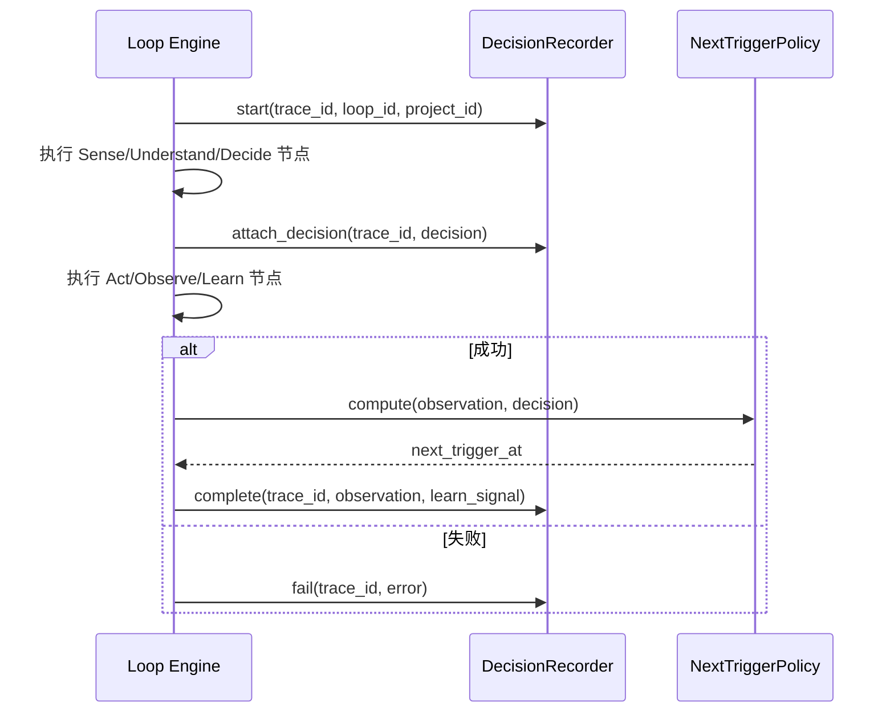

# 04. Decision Record 设计

> 状态：设计草案。
> 目的：把现状中 Observe/Learn 阶段最具复用价值的 `backend/services/decision_recording_service.py` 抽象为平台级可观测性与学习信号模块。
> 关联：`docs/00-现状架构与平台化分析报告.md` §4、§5.1；`docs/01-六阶段接口契约.md`（Observe/Learn 阶段）

---

## 1. 定位

Decision Record 模块为每一次 Loop 运行提供**全生命周期的运行记录**，回答三个问题：

1. 这次决策是什么、依据是什么、置信度多少？（决策留痕）
2. 执行结果如何、是否符合预期？（Observe）
3. 下一次什么时候该再决策？（Learn 的一种最基础信号：调度反馈）

Decision Record **不**：
- 不规定"风险等级"这类具体取值表（现状 `decision_recording_service.py` 里风险等级对应的间隔分钟数是养殖场景的经验值，属于参考实现的策略参数）；
- 不直接执行 Loop（只被动接收 Loop Engine 的事件钩子写入记录）。

---

## 2. 现状能力映射

| 现状实现 | 能力 | 平台化后的接口 |
|---|---|---|
| `DecisionRecordingService.start_run` | 开始一次决策运行记录 | `DecisionRecorder.start(trace_id, decision_context)` |
| `DecisionRecordingService.mark_success` | 标记成功 + 记录 next_decision | `DecisionRecorder.complete(trace_id, observation, learn_signal)` |
| `DecisionRecordingService.mark_failed` | 标记失败 | `DecisionRecorder.fail(trace_id, error)` |
| `parse_and_clamp_next_decision` | 按风险等级裁剪下次决策时间 | `NextTriggerPolicy.compute(observation) -> datetime`（可插拔策略） |
| `FeedingTaskSchedulerService.run_adaptive_decision_check` | 按 `next_decision_at` 触发下一次 Loop | Loop Engine 的调度触发器（依赖本模块产出的 `next_trigger_at`） |

---

## 3. 数据模型

```python
@dataclass
class DecisionRun:
    trace_id: str
    loop_id: str
    project_id: str
    status: Literal["running", "success", "failed"]
    decision: Decision | None        # 引用 01 中定义的 Decision
    started_at: datetime
    finished_at: datetime | None
    observation: ObservationRecord | None
    learn_signal: LearnSignal | None
    error: str | None
```

```python
class DecisionRecorder(Protocol):
    async def start(self, trace_id: str, loop_id: str, project_id: str) -> None: ...
    async def attach_decision(self, trace_id: str, decision: Decision) -> None: ...
    async def complete(
        self, trace_id: str, observation: ObservationRecord, learn_signal: LearnSignal
    ) -> None: ...
    async def fail(self, trace_id: str, error: str) -> None: ...
    async def get(self, trace_id: str) -> DecisionRun: ...
    async def list_pending_triggers(self, before: datetime) -> list[DecisionRun]:
        """查询 next_trigger_at <= before 的运行记录，供调度器拉取。"""
```

---

## 4. NextTriggerPolicy：把"风险等级表"变成可插拔策略

现状问题（报告 §5.3 已指出）：`decision_recording_service.py` 把"风险等级 → 下次决策间隔"的具体数值硬编码在通用记录服务里。平台化设计：

```python
class NextTriggerPolicy(Protocol):
    def compute(self, observation: ObservationRecord, decision: Decision) -> datetime:
        """根据观测结果和决策上下文，计算下次触发时间。"""
```

- 平台提供**一个最简默认实现**（例如固定间隔），不内置任何风险等级语义。
- Aquaculture 参考实现提供自己的 `FeedingRiskTriggerPolicy`，把现状的风险等级表迁移到这里（作为参考实现的策略插件，不进入平台代码）。
- `DecisionRecorder.complete` 内部调用注入的 `NextTriggerPolicy` 计算 `next_trigger_at`，写入 `DecisionRun`。

---

## 5. 与 Loop Engine 的集成方式



- 通过 `02-LoopEngine设计.md` §5 定义的事件钩子（`on_node_start` / `on_node_end` / `on_loop_complete`）自动调用上述接口，**业务节点代码里不需要手写"记录决策"的逻辑**（这是对现状"记录代码散落在业务脚本里"的直接改进）。
- Decision Record 因此天然获得了报告 §4 提到的"结构化程度不统一"问题的解法：只要接入 Loop Engine，任何 Loop（对话/喂食/设备控制）都自动产生同构的 `DecisionRun` 记录，不再是"喂食决策有结构化记录、对话只有日志"的不一致状态。

---

## 6. 调度触发器（与现状 `FeedingTaskSchedulerService` 对应）

- 平台提供一个通用的 `TriggerScanner`：定期调用 `DecisionRecorder.list_pending_triggers(now)`，对到期的记录触发对应 `LoopSpec` 的新一次运行。
- 这一能力使"定时/自适应再决策"成为平台通用调度机制，而不需要每个项目各写一套（对应报告 §5.1 指出的"三个仓库各写了一套调度器，应收敛"）。
- 调度器本身（如何轮询、用 APScheduler 还是别的）属于 `05-仓库目录结构规划.md` 中 `scheduling/` 模块的职责，Decision Record 只负责提供"哪些记录到期了"的查询接口。

---

## 7. 可观测性附加能力（超出现状，建议纳入平台设计）

现状缺失、但属于"决策记录"这个能力自然延伸的部分，建议在后续实现中一并考虑：

- **审计追溯**：给定 `trace_id`，能查出完整的 Sense→Learn 六份数据（需要 Decision Record 与各阶段的原始数据做关联存储，或至少存储关键摘要+外链）。
- **统计视图**：按 `project_id` / `loop_id` 统计成功率、平均置信度、平均决策间隔，用于评估某个 Loop 的"决策质量"，这是现状完全没有的能力。

---

## 8. 已确认事项（2026-07-10，见 docs/08）

- **A2 - SQL Adapter 已实现**：`adp/observability/adapters/sql.py` 提供 `SqlDecisionRecorder`（SQLAlchemy async，新建平台级表 `adp_decision_runs`，不复用现状 `work_tasks` 表结构——平台表结构以 `DecisionRun` 契约为准）。`decision`/`observation`/`learn_signal` 三个核心字段类型固定（`Decision`/`ObservationRecord`/`LearnSignal`），读回时精确重建为对应 dataclass（而不是像 `LoopRun.state` 那样只做泛化 JSON 序列化），因为这三者是平台契约类型而非任意业务对象。测试见 `tests/test_sql_decision_recorder.py`。
- `DecisionRun` 保留完整的六阶段中间数据（`decision`/`observation`/`learn_signal`），不做"只存摘要+外链"的裁剪——当前规模下没有必要提前优化。
- 统计视图**不是**本模块职责：本模块只负责数据产出（`DecisionRun` 表 + `list_pending_triggers`），统计展示留给上层（未来可能的"平台监控"模块直接查询本模块的存储即可）。
