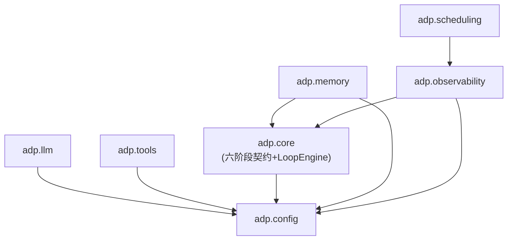

# 05. 仓库目录结构规划

> 状态：**已实施**。以下结构与代码现状一致（`core`/`memory`/`observability`/`llm`/`tools`/`config`/`scheduling` 均已实现，不再是占位）。本文档保留原始规划意图，第 2/3 节已更新为实际目录/职责。
> 关联：`docs/00-现状架构与平台化分析报告.md` §6；`docs/01~10` 设计文档

---

## 1. 规划原则

1. 目录结构按**能力模块**划分，不按"六阶段"划分——因为六阶段是运行时概念（契约+编排），而模块是代码组织概念（LLM/Memory/Observability 等横切能力各自独立）。
2. 本轮**深入设计**的三个模块（`core` 中的 Loop Engine、`memory`、`observability`）会给出更细的子结构；其余模块（`llm`/`tools`/`scheduling`/`config`）**只占位**，留待后续迭代详细设计。
3. `adp` 包本身**不依赖**任何具体参考实现（不 import aquaculture 相关代码），保证平台可独立发布。
4. 参考实现如何接入 ADP 的示例代码放在 `examples/`，本轮同样只占位，不写代码。

---

## 2. 目录结构

```
ADP/
├── README.md
├── docs/
│   ├── 00-现状架构与平台化分析报告.md
│   ├── 01-六阶段接口契约.md
│   ├── 02-LoopEngine设计.md
│   ├── 03-Memory设计.md
│   ├── 04-DecisionRecord设计.md
│   ├── 05-仓库目录结构规划.md
│   ├── 06-LLMGateway设计.md
│   ├── 07-ToolFramework设计.md
│   ├── 08-待确认事项汇总.md
│   ├── 09-Config设计.md
│   └── 10-Scheduling设计.md
│
├── adp/
│   ├── __init__.py
│   │
│   ├── core/                        # 六阶段契约 + Loop Engine（见 01/02）
│   │   ├── contracts.py             # SenseEvent/Context/Decision/ActResult/ObservationRecord/LearnSignal
│   │   ├── stages.py                # SenseStage/UnderstandStage/.../LearnStage 六个 Protocol
│   │   ├── run.py                   # LoopRun（可持久化的运行状态）
│   │   ├── store.py                 # LoopRunStore Protocol + InMemoryLoopRunStore
│   │   ├── engine.py                # LoopEngine 运行时：start/resume
│   │   ├── spec.py                  # NodeSpec/LoopSpec/RouteResult/RouterFn
│   │   ├── registry.py              # LoopRegistry：插件注册、build_loop
│   │   └── adapters/
│   │       └── sql.py               # SqlLoopRunStore（SQLAlchemy async）
│   │
│   ├── memory/                      # 记忆模块（见 03）
│   │   ├── contracts.py             # ShortTermEntry/MemoryNode 数据结构
│   │   ├── short_term.py            # ShortTermMemory Protocol + InMemory 实现
│   │   ├── long_term.py             # LongTermMemory Protocol + TopicResolver 接口
│   │   └── adapters/
│   │       └── sql.py               # SqlShortTermMemory / SqlLongTermMemory
│   │
│   ├── observability/               # 决策记录/可观测性（见 04）
│   │   ├── contracts.py             # DecisionRun 数据结构
│   │   ├── recorder.py              # DecisionRecorder Protocol + InMemory 实现
│   │   ├── trigger_policy.py        # NextTriggerPolicy Protocol + 平台默认最简实现
│   │   └── adapters/
│   │       └── sql.py               # SqlDecisionRecorder
│   │
│   ├── llm/                         # LLM Gateway（见 06）
│   │   ├── contracts.py             # LLMMessage/LLMRequest/LLMResponse
│   │   ├── provider.py              # LLMProvider Protocol + OpenAICompatibleProvider
│   │   ├── gateway.py                # LLMGateway：路由 + 重试
│   │   └── prompts.py                # PromptRegistry + FilePromptSource
│   │
│   ├── tools/                       # 工具调用框架（见 07）
│   │   ├── contracts.py             # ToolSpec/ToolResult/ToolCallRequest
│   │   ├── registry.py               # ToolRegistry：静态/动态注册
│   │   └── executor.py               # ToolExecutor：超时/权限校验/批量执行
│   │
│   ├── scheduling/                  # 通用调度器（见 10）
│   │   ├── scheduler.py              # AsyncScheduler：进程内 asyncio 定时任务
│   │   └── trigger_scanner.py        # TriggerScanner：轮询 DecisionRecorder.list_pending_triggers
│   │
│   ├── config/                      # 分层配置（见 09）
│   │   └── settings.py               # DatabaseSettings/LLMSettings/SchedulingSettings/PlatformSettings
│   │
│   └── serialization.py             # to_json_safe/ensure_utc：SQL adapter 共用的序列化工具
│
├── examples/
│   └── aquaculture_feeding_loop/    # 端到端示例：养殖喂食决策场景跑通 core+memory+observability+llm+tools
│
├── tests/                           # 平台自身的单元测试（覆盖以上全部模块）
└── pyproject.toml
```

---

## 3. 模块职责一览表

| 模块 | 状态 | 职责 | 对应设计文档 |
|---|---|---|---|
| `adp/core` | 已实现 | 六阶段契约定义 + Loop Engine 运行时（图编排、生命周期、事件钩子、`LoopRun` 持久化） | `01`、`02` |
| `adp/memory` | 已实现 | 短期/长期记忆接口 + InMemory/SQL 实现 | `03` |
| `adp/observability` | 已实现 | 决策记录、下次触发策略、SQL 持久化 | `04` |
| `adp/llm` | 已实现 | LLM 调用封装、Provider 抽象、重试、Prompt 管理 | `06` |
| `adp/tools` | 已实现 | 工具注册表、执行器（超时/权限校验/批量执行） | `07` |
| `adp/scheduling` | 已实现 | 通用调度器原语（`AsyncScheduler`）+ 与 `observability` 联动的 `TriggerScanner` | `10` |
| `adp/config` | 已实现 | 分层配置（平台默认 + 环境变量覆盖 + 业务子类扩展），供各模块读取 | `09` |
| `examples/` | 已实现 | 养殖喂食决策场景端到端示例，验证 `core`+`memory`+`observability`+`llm`+`tools` 集成 | - |

---

## 4. `adp/observability` 与 `adp/scheduling` 的边界说明

容易混淆的两个模块，明确边界：

- `adp/scheduling.AsyncScheduler`：提供**通用定时器原语**（"每 N 秒执行一次"、"N 秒后执行一次"），不知道"决策""Loop"这些概念，可以被平台内任何模块使用（甚至与 Loop Engine 无关的场景）。
- `adp/scheduling.TriggerScanner`：**决策记录+到期扫描的领域接口**的落地实现，依赖 `AsyncScheduler`（作为一个被注册的定时任务）和 `adp.observability.DecisionRecorder.list_pending_triggers`，对外暴露的是"决策什么时候该再触发"这个语义，而不是裸的 cron/interval。放在 `adp/scheduling` 而不是 `adp/observability` 下，是因为它本质上是"调度器的一种业务用法"，`observability` 模块本身不依赖 `scheduling`（依赖方向见下方 §5）。

这一分层对应报告中指出的"三个仓库各写一套调度器"问题：拆成"底层定时器"（`AsyncScheduler`）和"决策触发语义"（`TriggerScanner`）两层后，未来任何 Loop（不仅是喂食）都可以复用同一套调度机制。详细结论见 `docs/10-Scheduling设计.md`。

---

## 5. 依赖方向约束



- `adp.core` 只依赖 `adp.config`，不依赖 `memory`/`observability`/`llm`/`tools`/`scheduling`（通过事件钩子解耦，符合 `02-LoopEngine设计.md` §5 的设计）。
- `memory`、`observability` 依赖 `core` 中定义的契约类型（如 `LearnSignal`、`Decision`）以及 `config`（数据库连接），但 `core` 不反向依赖它们。
- `scheduling.TriggerScanner` 依赖 `observability.DecisionRecorder`（这是唯一一处"调度器知道决策语义"的地方，`scheduling.AsyncScheduler` 本身不依赖任何其他 `adp` 模块）。
- 任何参考实现（Aquaculture）只应依赖 `adp` 顶层公开的接口，不应依赖 `adp.*.adapters` 等内部实现细节（除非显式选择某个 SQL Adapter 作为存储后端）。

---

## 6. 与报告 §5 迁移建议的对应关系

| 报告 §5.1 建议迁移的能力 | 对应本目录结构位置 |
|---|---|
| LLM Gateway | `adp/llm/`（占位） |
| Prompt Registry | 建议归入 `adp/llm/prompts.py`（占位，后续设计时确定是否独立成 `adp/prompts/`） |
| 决策图引擎 | `adp/core/engine.py` + `spec.py` + `registry.py` |
| 工具调用框架 | `adp/tools/`（占位） |
| 意图识别/路由框架 | 属于 `UnderstandStage` 的一种参考实现模式，不在平台包内固化，放在 `examples/` 或未来的"意图识别工具库" |
| 记忆管理 | `adp/memory/` |
| 任务调度 | `adp/scheduling/scheduler.py`（底层原语）+ `adp/scheduling/trigger_scanner.py`（决策触发语义，依赖 `observability`） |
| 决策记录/可观测性 | `adp/observability/` |
| Act 执行网关 | 建议作为 `adp/core` 契约里的 `ActStage` 实现指引，具体协议客户端（HTTP/SSE/MQTT）留在参考实现或未来的 `adp/executors/`（本轮未单独占位，待后续设计时决定是否需要独立模块） |
| 会话/状态管理 | 归入 `adp/memory`（短期记忆）+ 未来可能的 `adp/session/`（多轮确认状态机，本轮未占位，待评估是否并入 memory 还是独立） |
| 配置管理范式 | `adp/config/` |
| WebSocket/流式通信协议 | 本轮未占位，属于"接入层"而非"决策平台核心"，建议作为参考实现自己的技术选型，待后续讨论是否需要平台化 |

---

## 7. 待确认事项（更新于 2026-07-10）

- **A3（本轮明确不讨论，留待后续专题）**：`Act 执行网关`、`会话/状态管理`、`WebSocket通信协议` 三项在依赖图中位置仍未定，是否需要单独的模块目录（如 `adp/executors/`、`adp/session/`）留作开放问题。
- ~~`examples/aquaculture_feeding_loop/` 是否实现为可运行示例~~ —— **已完成**：`examples/aquaculture_feeding_loop/` 是一个可运行的端到端示例（`run_demo.py`），覆盖 `core`+`memory`+`observability`+`llm`+`tools` 五个模块的集成。
- ~~是否需要从第一天引入 `pyproject.toml`~~ —— **已确定**：已引入，见 `pyproject.toml`（`sql` extra 提供 `sqlalchemy`+`aiosqlite`，核心依赖含 `pydantic`/`pydantic-settings`）。
