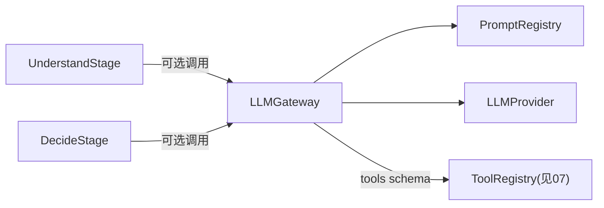

# 06. LLM Gateway 设计

> 状态：设计草案。
> 目的：把现状中被独立实现三次的 LLM 调用封装（`agent_new/core/llm.py`、`deviceagent/llms/llm_manager.py`、`agent/agents/llm_utils.py`）收敛为平台统一的 LLM Gateway。
> 关联：`docs/00-现状架构与平台化分析报告.md` §3.2、§5.1；`docs/01-六阶段接口契约.md`（Understand/Decide 阶段的可选依赖）；`docs/02-LoopEngine设计.md`（复用 `RetryPolicy`）

---

## 1. 定位

LLM Gateway 提供**统一的模型调用入口**，屏蔽不同 Provider（OpenAI 兼容 API、未来可能的其他厂商 API）的差异，并内置 Prompt 管理子能力。

LLM Gateway **不**：
- 不规定业务侧必须使用 LLM 完成 Understand/Decide（`01-六阶段接口契约.md` 中两个阶段允许纯规则实现）；
- 不包含任何业务 Prompt 内容（内容由参考实现通过 `PromptRegistry` 注册，平台只提供加载/渲染机制）；
- 不做意图路由或工具调用编排（工具调用属于 `07-ToolFramework设计.md`，LLM Gateway 只负责把工具 schema 传给 Provider 并回传模型的调用意图）。

---

## 2. 现状能力映射

| 现状实现 | 能力 | 平台化后的接口 |
|---|---|---|
| `agent_new/core/llm.py` `LLMManager.invoke` | 非流式调用 | `LLMGateway.complete(request)` |
| `agent_new/core/llm.py` 流式接口 | 流式调用 | `LLMGateway.stream(request)` |
| `agent_new/core/llm.py` `set_request_model()` | 按请求覆盖模型 | `LLMRequest.model` 显式传入即可覆盖默认模型 |
| `deviceagent/llms/llm_manager.py` | 带工具调用的 LLM 封装 | `LLMRequest.tools` |
| `agent_new/prompts/__init__.py` `load_prompt()` | 文件加载 Prompt | `PromptRegistry` 的文件源 |
| `cognitive_model/config/prompt_manager.py` | DB/文件双源加载 Prompt | `PromptRegistry` 的多源加载器 |

---

## 3. 数据模型

```python
@dataclass
class LLMMessage:
    role: Literal["system", "user", "assistant", "tool"]
    content: str
    tool_call_id: str | None = None      # 工具结果消息时使用

@dataclass
class ToolSchema:
    name: str
    description: str
    parameters: dict[str, Any]           # JSON Schema

@dataclass
class LLMRequest:
    request_id: str                      # 用于追踪/按请求覆盖模型
    model: str | None                    # None 时使用 Gateway 默认模型
    messages: list[LLMMessage]
    tools: list[ToolSchema] | None = None
    timeout_seconds: float | None = None
    temperature: float | None = None
    extra: dict[str, Any] = field(default_factory=dict)   # Provider 特有参数透传

@dataclass
class ToolCallRequest:
    tool_name: str
    arguments: dict[str, Any]
    call_id: str

@dataclass
class LLMResponse:
    request_id: str
    content: str | None
    tool_calls: list[ToolCallRequest] = field(default_factory=list)
    usage: dict[str, int] | None = None     # token 用量，便于成本观测
    raw: Any = None                          # Provider 原始返回，便于调试

@dataclass
class LLMChunk:
    request_id: str
    delta: str | None
    tool_call_delta: dict[str, Any] | None = None
    finished: bool = False
```

---

## 4. 接口定义

### 4.1 Provider（可插拔）

```python
class LLMProvider(Protocol):
    async def complete(self, request: LLMRequest) -> LLMResponse: ...
    async def stream(self, request: LLMRequest) -> AsyncIterator[LLMChunk]: ...
```

- 平台第一版内置 `OpenAICompatibleProvider`：所有现状实现底层都是 OpenAI 兼容 API（含第三方兼容网关），这是复用成本最低的默认实现。
- 未来新增 Provider（如原生 Anthropic API）只需实现同一 Protocol，不影响 Gateway 上层逻辑。

### 4.2 LLMGateway

```python
class LLMGateway:
    def __init__(self, default_provider: LLMProvider, default_model: str, retry: RetryPolicy | None = None): ...

    async def complete(self, request: LLMRequest) -> LLMResponse: ...
    async def stream(self, request: LLMRequest) -> AsyncIterator[LLMChunk]: ...

    def register_provider(self, name: str, provider: LLMProvider) -> None:
        """支持多 Provider 场景：request.extra['provider'] 指定使用哪个。"""
```

- 重试/超时**复用** `02-LoopEngine设计.md` 中定义的 `RetryPolicy` 数据结构（而不是重新定义一套），保证平台内"重试"的语义统一。
- `complete`/`stream` 内部按 `request.model` 覆盖 `default_model`，对应现状"按请求切换模型"的能力。

### 4.3 PromptRegistry

```python
@dataclass
class PromptTemplate:
    template_id: str
    content: str            # 原始模板文本（含变量占位符）
    source: Literal["file", "db"]
    version: str | None = None

class PromptSource(Protocol):
    async def load(self, template_id: str) -> PromptTemplate | None: ...

class PromptRegistry:
    def __init__(self, sources: list[PromptSource]): ...   # 按顺序尝试加载，第一个命中即用

    async def render(self, template_id: str, variables: dict[str, Any]) -> str:
        """加载模板并做变量替换，返回可直接作为 LLMMessage.content 使用的字符串。"""
```

- `sources` 顺序体现"文件优先/DB兜底"或反之，由参考实现在初始化时决定顺序，平台不强制。
- 平台第一版提供 `FilePromptSource`（对应 `agent_new/prompts/*.md`）作为默认实现；`DbPromptSource` 作为可选扩展点（对应 `cognitive_model` 的 DB 驱动 Prompt），本轮不实现，仅定义接口。

---

## 5. 与其他模块的关系



- LLM Gateway 与 `01-六阶段接口契约.md` 的关系：属于**参考实现的实现细节**，不是 Loop Engine 强制依赖的模块（Loop Engine 只认识六阶段 Protocol，不知道内部是否用了 LLM Gateway）。
- 与 `07-ToolFramework设计.md` 的边界：LLM Gateway 只负责把 `ToolSchema` 传给 Provider 并解析模型返回的 `tool_calls`；**是否执行**这些工具调用、如何执行，属于工具框架的职责。

---

## 6. 可观测性钩子

- `LLMGateway` 每次 `complete`/`stream` 调用应产生一条可选的调用日志（`request_id`、耗时、token 用量、是否重试），供上层（如 `04-DecisionRecord设计.md` 里的 `DecisionRun`）在需要时关联展示，但**不强制**写入 Decision Record（避免 LLM Gateway 反向依赖 observability 模块，保持 `05-仓库目录结构规划.md` 中的依赖方向约束）。

---

## 7. 待确认事项

- 是否需要在 Gateway 层做**跨请求的速率限制/并发控制**（现状未见相关实现，可能是运维层面配置的，需确认是否要平台化）。
- `PromptTemplate` 的变量替换语法选型（简单 `str.format` 还是引入 Jinja2 等模板引擎），现状 `agent_new` 用的是较简单的占位符替换。
- 多 Provider 场景（`register_provider`）是否是第一版必须支持的能力，还是可以推迟——现状三处实现都只对接了一个 Provider。
