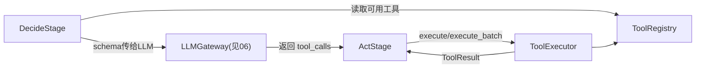

# 07. 工具调用框架设计

> 状态：设计草案。
> 目的：把现状中两种并存的工具调用模式（`deviceagent/tools/tool_provider.py` 的静态 LangChain `@tool` 注册、`cognitive_model/tools/tool_registry.py` 的 DB 驱动动态注册）收敛为平台统一的工具调用框架。
> 关联：`docs/00-现状架构与平台化分析报告.md` §3.2、§5.1；`docs/06-LLMGateway设计.md`（工具 schema 传递）；`docs/01-六阶段接口契约.md`（Act 阶段可能借助工具执行）

---

## 1. 定位

工具调用框架提供**工具的注册、发现与执行**能力，是 Decide/Act 阶段可选依赖的横切能力（类似 LLM Gateway，不是 Loop Engine 强制要求）。

工具框架**不**：
- 不包含任何具体工具的业务实现（喂食机控制、MAC 设备控制等属于参考实现注册的工具，不进入平台代码）；
- 不做工具调用的编排决策（"要不要调用某个工具""调用后结果怎么整合进对话"由参考实现的 Decide/Act 阶段 handler 决定，框架只负责"注册了哪些工具"和"执行一次调用"）。

---

## 2. 现状能力映射

| 现状实现 | 能力 | 平台化后的接口 |
|---|---|---|
| `deviceagent/tools/tool_provider.py` + `@tool` 装饰器 | 静态代码注册工具，按 category 分发 | `ToolRegistry.register(spec)`（静态注册模式） |
| `deviceagent/graph/agent_manager.py` 工具调用限制 | 限制单次 Agent 可用工具数量/超时 | `ToolExecutor` 的超时与调用次数控制 |
| `cognitive_model/tools/tool_registry.py` | 数据库驱动的动态工具加载，含 SSE/HTTP 工具 | `ToolRegistry` 的动态数据源（`DbToolSource`，本轮仅占位接口） |
| `cognitive_model/tasks/task_handler.py` | 异步工具调用任务的生命周期管理 | 归入 `ToolExecutor` 的异步执行分支（本轮仅记录待确认） |

---

## 3. 数据模型

```python
@dataclass
class ToolParameterSchema:
    json_schema: dict[str, Any]     # 标准 JSON Schema，供 LLM Provider 使用

@dataclass
class ToolSpec:
    name: str                        # 全局唯一
    description: str
    parameters: ToolParameterSchema
    category: str | None = None      # 对应现状 deviceagent 的 category 分发（feeder/mac等，平台不预设具体值）
    handler: Callable[..., Awaitable[Any]] | None = None   # 静态注册时提供；动态注册时可为 None，由 ToolExecutor 按 name 路由到远程调用
    timeout_seconds: float | None = None

@dataclass
class ToolResult:
    tool_name: str
    call_id: str
    status: Literal["success", "failed", "timeout"]
    output: Any
    error: str | None = None
    duration_ms: float | None = None
```

---

## 4. 接口定义

### 4.1 ToolRegistry

```python
class ToolSource(Protocol):
    async def list_tools(self) -> list[ToolSpec]: ...

class ToolRegistry:
    def register(self, spec: ToolSpec) -> None:
        """静态注册，对应 deviceagent 的 @tool 装饰器模式。"""

    def add_source(self, source: ToolSource) -> None:
        """添加动态数据源，对应 cognitive_model 的 DB 驱动注册。"""

    async def get(self, name: str) -> ToolSpec | None: ...
    async def list(self, category: str | None = None) -> list[ToolSpec]: ...
    async def to_llm_schemas(self, category: str | None = None) -> list[ToolSchema]:
        """转换为 06-LLMGateway设计.md 中定义的 ToolSchema 列表，供 LLMRequest.tools 使用。"""
```

- `register`（静态）与 `add_source`（动态）**并存**，`list`/`get` 内部会合并两类来源的结果，对上层调用方屏蔽来源差异。
- `DbToolSource` 是 `ToolSource` 的一种实现，属于参考实现层（因为"从哪个数据库、哪张表读取工具定义"是部署细节），平台只定义 `ToolSource` 接口。

### 4.2 ToolExecutor

```python
class ToolExecutor:
    def __init__(self, registry: ToolRegistry, default_timeout_seconds: float = 30.0): ...

    async def execute(self, tool_name: str, arguments: dict[str, Any], call_id: str) -> ToolResult:
        """查找 ToolSpec，调用其 handler（若为静态工具）或路由到远程调用（若为动态工具），
        统一处理超时与异常，返回标准化 ToolResult。"""

    async def execute_batch(self, calls: list[ToolCallRequest]) -> list[ToolResult]:
        """并发执行多个工具调用（LLM 一次返回多个 tool_calls 的常见场景）。"""
```

- 对应现状 `agent_manager.py` 里"限制单次 Agent 可用工具数量/超时"的能力，在 `execute`/`execute_batch` 层面统一处理，而不是分散在每个设备 Agent 的初始化代码里。
- 权限校验（如"这个 call_id 所属的会话是否有权限调用该工具"）本轮设计为**占位扩展点**（`ToolExecutor` 构造时可选传入一个 `PermissionChecker`），不做具体实现。

---

## 5. 与其他模块的关系



- 与 `01-六阶段接口契约.md` 的 `ActStage` 的关系：工具执行是 `ActStage` 具体实现的一种手段（另一种是直接调用 Executor/外部 Agent，如现状的 `device_expert_service`），两者不互斥，参考实现可以同时使用。

---

## 6. 两种注册模式的适用场景说明（不做强制选择）

| 模式 | 适用场景 | 现状对应 |
|---|---|---|
| 静态注册 | 工具集合在部署时确定、变更需要发版 | `deviceagent` 的喂食机/MAC工具 |
| 动态注册 | 工具集合需要运营人员在管理后台增删、无需发版 | `cognitive_model` 的 DB 驱动工具 |

参考实现可以混用两种模式（如核心设备工具静态注册、实验性工具动态注册），`ToolRegistry` 的设计已支持两者共存。

---

## 7. 待确认事项

- `execute_batch` 的并发度是否需要限制（现状 `agent_manager.py` 有"工具调用限制"，具体阈值是养殖场景经验值，平台第一版建议先不设默认限制，由参考实现通过 `default_timeout_seconds`/未来的并发参数配置）。
- `PermissionChecker` 扩展点是否在本阶段就需要一个最简默认实现（如"全部允许"），还是完全留空到下一阶段设计。
- 异步长任务型工具（对应 `cognitive_model/tasks/task_handler.py` 的任务生命周期管理，如"提交后轮询结果"的工具）是否需要在 `ToolResult` 之外单独设计一个 `AsyncToolHandle`，本轮暂不展开，记录为后续设计项。
