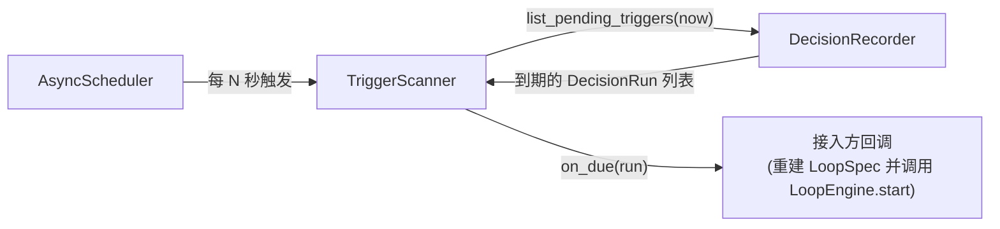

# 10. 通用调度器设计

> 状态：设计草案（已确认，见 `docs/08` A4 / 专题讨论1）。
> 目的：收敛现状三套各自实现的调度器（`ai_japan/src/scheduler`、`deviceagent/scheduler/task_scheduler.py`、`backend/services/shared_scheduler_service.py`）为平台统一的、无状态的定时器原语。
> 关联：`docs/00` §5.1；`docs/04-DecisionRecord设计.md` §6；`docs/05-仓库目录结构规划.md` §4

---

## 1. 定位与边界

`adp/scheduling` 只提供**通用定时器原语**：

- "每隔 N 秒执行一次回调"
- "每天固定时间执行一次回调"（本轮先实现固定间隔，daily 作为后续扩展，见 §5）

`adp/scheduling` **不**：
- 不知道"决策""Loop""DecisionRun"这些概念；
- **不持久化任何任务列表**——这是本轮的关键确认：调度器本身是无状态的，重启后不需要"恢复任务"，因为它的每一轮轮询都是重新去问"现在有什么到期了"，而"到期的是什么"这件事完全由 `adp.observability.DecisionRecorder.list_pending_triggers()` 回答。

这与 `docs/05` §4 的分层设计完全一致：**scheduling = 底层定时器，observability = "决策何时该再触发"的语义层**。

## 2. 现状能力映射

| 现状实现 | 能力 | 平台化后 |
|---|---|---|
| `deviceagent/scheduler/task_scheduler.py` | 线程池轮询 + DB 持久化任务 + 重启恢复 | 拆分：轮询能力 → `AsyncScheduler`；持久化/恢复能力 → 不需要了（因为轮询目标改为查询 `list_pending_triggers`，天然"随查随得"，无需恢复） |
| `backend/services/shared_scheduler_service.py` | APScheduler 封装 | 替换为平台的 `AsyncScheduler`（asyncio 原生，不引入 APScheduler 依赖） |
| `ai_japan/src/scheduler/task_scheduler.py` | 定时/一次性任务调度 | 同上，收敛为一套 |

## 3. 数据模型与接口

```python
@dataclass
class PeriodicTaskHandle:
    name: str
    interval_seconds: float

class AsyncScheduler:
    def add_periodic(
        self, name: str, interval_seconds: float, callback: Callable[[], Awaitable[None]]
    ) -> PeriodicTaskHandle:
        """注册一个周期性回调；``callback`` 不接收参数、不返回值，
        具体"做什么"完全由调用方在闭包里决定。"""

    def remove(self, name: str) -> None: ...

    async def start(self) -> None:
        """并发运行所有已注册的周期性任务，直到 stop() 被调用。"""

    async def stop(self) -> None: ...
```

- `callback` 内部异常不应导致整个调度器崩溃：`AsyncScheduler` 捕获单次回调的异常并记录日志，下一轮继续执行（对应现状 `task_scheduler.py` 的容错设计）。
- 调度器**不提供**"任务列表查询"接口（如"当前注册了哪些周期任务"以外的业务语义查询），因为它不存储业务数据。

## 4. 与 Decision Record 的集成方式（`TriggerScanner`）

`adp/observability` 内新增 `TriggerScanner`，作为 `AsyncScheduler` 的一个具体使用者，桥接"轮询"与"决策到期语义"：

```python
class TriggerScanner:
    def __init__(
        self,
        recorder: DecisionRecorder,
        scheduler: AsyncScheduler,
        on_due: Callable[[DecisionRun], Awaitable[None]],
        poll_interval_seconds: float = 30.0,
        name: str = "decision-trigger-scan",
    ) -> None: ...

    def start(self) -> None:
        """向 scheduler 注册一个周期任务：调用 recorder.list_pending_triggers(now)，
        对每条到期记录调用 on_due(record)。"""

    def stop(self) -> None: ...
```



- `on_due` 回调由接入方提供，回调内部具体怎么用 `run.loop_id`/`run.project_id` 重建 `LoopSpec` 并调用 `LoopEngine.start(...)`，`TriggerScanner` 不关心——这保持了 `adp.observability` 不反向依赖 `adp.core` 的运行时（只依赖其契约类型，符合 `docs/05` §5 的依赖方向约束）。
- 由于调度器本身无状态，进程重启后 `TriggerScanner` 只需要重新 `start()`，下一次轮询自然会重新捞出所有到期记录，不需要专门的"恢复"步骤。

## 5. 待确认事项

- Daily（固定时刻触发一次）调度原语本轮不实现，仅设计了 `add_periodic`（固定间隔）。若未来需要，可以在 `AsyncScheduler` 上新增 `add_daily(name, hour, minute, callback)`，不影响现有接口。
- `TriggerScanner` 对同一条到期记录的"去重"策略（避免同一个 `DecisionRun` 因为 `on_due` 处理较慢、被下一轮轮询重复捞出）本轮暂未处理，留待接入方自行在 `on_due` 里做幂等处理（例如先检查/更新状态），或后续版本在 `TriggerScanner` 内加一个"处理中"的短期去重集合。
