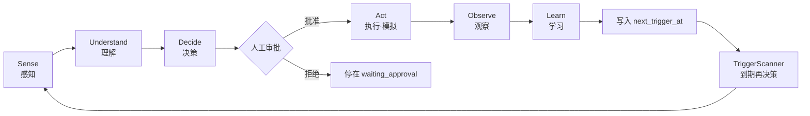

# ADP 完整决策链路执行流程（汇报版）

**日期**：2026-07-10  
**场景**：日本陆上养殖 · 5号池（`POND_005`）投喂决策  
**验证环境**：真实阿里云 MySQL（隔离库 `adp_test`）+ 真实 LLM；Act 阶段模拟，不触发真实设备  
**用途**：汇报展示 ADP 自主决策闭环如何跑通

---

## 一句话结论

ADP 已在真实数据与真实 LLM 下跑通 **Sense → Understand → Decide →（人工审批）→ Act(模拟) → Observe → Learn → 定时再决策** 全链路；生产业务库只读、真实设备零触发。

---

## 1. 总览：一次决策怎么转起来



| 阶段 | 做什么 | 本次验证用的真实能力 |
|---|---|---|
| **Sense** | 采集池塘现状 | 读隔离库快照：传感器 / 虾况 / 喂食记录（源自生产只读拷贝） |
| **Understand** | 算出建议投喂量 | 移植生产投喂率表，确定性算出 **2.1 kg** |
| **Decide** | LLM 生成可审批说明 | 真实 LLM；prompt 含水温/溶氧/pH/虾况/`feed_calculation` |
| **审批门** | 人确认后才继续 | `waiting_approval` 中断 → 批准后 `resume` |
| **Act** | 下发执行 | **模拟** `trigger_feeder`，不连真实喂食机 |
| **Observe** | 记录执行结果 | 观察记录写入决策运行态 |
| **Learn** | 更新记忆 + 下次触发时间 | 长期记忆节点 + `next_trigger_at`（验证默认约 15s） |
| **再决策** | 到期自动开新一轮 | `TriggerScanner` 扫到到期后启动新 loop |

---

## 2. 数据与安全边界（汇报时建议先讲）

```text
┌─────────────────────────────┐     只读 SELECT      ┌──────────────────────────┐
│  生产库 japan_aquaculture   │ ──────────────────► │  隔离库 adp_test         │
│  （业务真实数据）            │   snapshot_copy     │  *_snapshot 业务快照     │
└─────────────────────────────┘                      │  adp_* 决策/记忆/运行表  │
                                                     └────────────┬─────────────┘
                                                                  │
                                                                  ▼
                                                     ADP Loop + 真实 LLM
                                                                  │
                                                                  ▼
                                                     Act = 模拟工具（无设备）
```

**三条硬约束（已兑现）**：

1. 生产库只读，从不写入业务表  
2. 所有 ADP 写入只落在 `adp_test`  
3. Act 不触发真实喂食设备  

云库可直接查看：`USE adp_test; SHOW TABLES;`

---

## 3. 分阶段执行细节（带真实跑通证据）

### 3.1 Sense — 感知

- **输入**：池塘内部 id = 5（业务 id `POND_005` / 5号池）  
- **动作**：从 `adp_test` 快照表取最新传感器、虾况、上次投喂、累计死亡  
- **快照规模（示例）**：sensor ≈ 2.0 万行，shrimp_stats 49，feeder_logs ≈ 2.2 千  

### 3.2 Understand — 理解（确定性计算）

- **动作**：`calculate_daily_feed_amount`（移植自生产 `feeding_rate_service`）  
- **输出**：`recommended_feed_kg = 2.1`  
- **原则**：数字由规则表算，不交给 LLM 编造  

### 3.3 Decide — 决策（真实 LLM）

- **动作**：把真实事实塞进 prompt（参考生产 `feeding_task_prompt.md` 核心约束）  
- **输出示例要点**（二次验证实际返回）：  
  - 引用水温 28.7℃、溶氧 ≈5.49 mg/L、pH 7.86  
  - 明确总投喂量引用系统预计算 **2.1 kg**  
  - 按【建议动作】【数据依据】【推理链路】【注意事项】结构输出  
- **状态**：`requires_approval=True` → 进入 `waiting_approval`

### 3.4 人工审批门

- 终端确认批准后 `LoopEngine.resume`  
- 拒绝则停在 `waiting_approval`，不进入 Act  

### 3.5 Act — 执行（模拟）

```text
simulated feeder call: [{'pond_id': 'POND_005', 'amount_kg': 2.1}]
```

仅记录参数，**无网络设备调用**。

### 3.6 Observe / Learn

- `DecisionRun.status = success`  
- 长期记忆：`{'last_amount_kg': 2.1, 'last_outcome': 'as_expected'}`  
- 写入 `next_trigger_at`（验证配置为完成后约 **15 秒**）

### 3.7 定时再决策（已验证）

命令：

```bash
python -m examples.aquaculture_live_validation.run_live_demo --rounds 2 --auto-approve --interval 15
```

实际结果：

| 轮次 | trace_id（节选） | 结果 | next_trigger_at |
|---|---|---|---|
| Round 1 | `...081212-r1` | completed / success | +15s |
| （等待） | TriggerScanner 扫到 r1 到期 | 触发下一轮 | — |
| Round 2 | `...081254-r2` | completed / success | 再写下一轮触发时间 |

说明：**再决策链路已通**。当前验证 CLI 用 `--rounds N` 控制跑几轮；要“一直持续”，需常驻挂着 `AsyncScheduler` + `TriggerScanner` 的进程。

---

## 4. 汇报可用的关键数字

| 指标 | 值 |
|---|---|
| 验证池塘 | `POND_005`（5号池） |
| 确定性投喂量 | **2.1 kg** |
| LLM | 真实调用（OpenAI 兼容接口） |
| 数据库 | 真实云 MySQL，隔离 schema `adp_test` |
| 生产写入 | **0** |
| 真实设备触发 | **0** |
| 单测 | 47 passed |
| 再决策验证 | 2 轮连跑成功（15s 间隔） |

---

## 5. 现场演示建议（3～5 分钟）

1. **先讲安全边界**（隔离库 + Act 模拟）——消除“会不会真喂虾”的顾虑  
2. **打开总览 mermaid**——六阶段 + 再决策闭环一眼看懂  
3. **展示一轮真实输出**：投喂量 2.1kg + LLM 引用了真实水质数字  
4. **展示再决策**：`--rounds 2` 或云库里两条 `adp_decision_runs`  
5. **收尾边界**：Act 仍模拟；常驻无限循环需调度进程；生产接入还要接真实设备网关  

复现命令：

```bash
cd /home/gmm/srv/ADP
python -m examples.aquaculture_live_validation.snapshot_copy --mode refresh
python -m examples.aquaculture_live_validation.run_live_demo --rounds 2 --auto-approve
```

---

## 6. 相关材料

| 材料 | 路径 |
|---|---|
| 本流程汇报稿 | `reports/2026-07-10-decision-flow-briefing.md` |
| Cursor 可视化看板 | 聊天旁打开 Canvas：`ADP-decision-flow-briefing` |
| 真实环境验证报告（工程细节） | `reports/2026-07-10-live-validation.md` |
| 持久化 + 调度验证 | `reports/2026-07-10-persistent-scheduling-verification.md` |
| 一期总验证 | `reports/2026-07-10-verification.md` |
| 示例说明 | `examples/aquaculture_live_validation/README.md` |

---

## 7. 一页纸口述稿（可选）

> 我们把养殖投喂决策抽象成 ADP 的六阶段闭环。感知读真实池塘数据，理解用生产同款投喂率公式算出 2.1 公斤，决策用真实大模型写可审批说明，人批准后才进入执行——验证里执行是模拟的，不会真喂。执行后写入观察与记忆，并登记下次触发时间；到期后调度器自动再开一轮。全程生产库只读、设备零触发，说明平台闭环在真实数据与真实模型下已经跑通。
